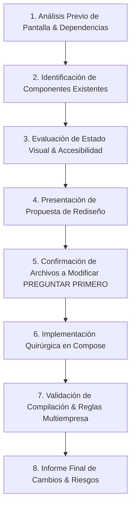

# Skill: ui-designer
**Versión**: 1.0.0  
**Contexto**: Diseño UI/UX, Sistemas Visuales y Adaptabilidad Multiempresa en Jetpack Compose

## 1. Propósito y Alcance

Guiar el diseño, mejora, refactorización visual y construcción de componentes de interfaz de usuario (UI) en el proyecto Android de **Formas Perfectas**.

Esta skill garantiza que cualquier evolución estética o de usabilidad:
- Respete el **sistema de temas dinámicos multiempresa** de la aplicación (`TemaEmpresa`, `TemaStore`, `AppDynamicTheme`).
- Implemente **Material Design 3 (M3)** utilizando tokens semánticos de color, tipografía y formas.
- Mantenga la **arquitectura MVVM** sin alterar la lógica de negocio en ViewModels, Repositorios, APIs, Autenticación ni Navegación.
- Asegure la **accesibilidad**, ergonomía táctil (áreas mínimas de 48.dp) y estados de UI explícitos (`Loading`, `Success`, `Empty`, `Error`).

---

## 2. Activación de la Skill

Esta skill DEBE activarse automáticamente cuando el usuario solicite:
- Rediseñar o mejorar la apariencia visual de cualquier pantalla o componente Compose.
- Crear nuevos composables, componentes reutilizables o vistas.
- Ajustar layouts, paletas visuales, estados de carga, tarjetas, formularios o diálogos.
- Auditar la accesibilidad, contraste, responsividad o adaptabilidad de la UI.

---

## 3. Principios Fundamentales (Reglas Inviolables)

### 🔴 Regla 1: Protección Absoluta del Tema Multiempresa
- **PROHIBIDO** hardcodear colores primarios, secundarios o de marca en valores HEX literales (ejemplo: `Color(0xFF...)`) dentro de los composables de las pantallas.
- **PROHIBIDO** reemplazar `AppDynamicTheme` o crear temas alternativos que compitan con la tematización global.
- **PROHIBIDO** alterar la estructura de [TemaStore.kt](file:///D:/Personal/Git-Proyectos/formasPerfectasAndroid/app/src/main/java/com/spa/appointments/core/theme/TemaStore.kt) o modificar el flujo de autenticación JWT / `IdEmpresa`.
- **OBLIGATORIO** consumir colores exclusivamente a través de `MaterialTheme.colorScheme` (ej: `MaterialTheme.colorScheme.primary`, `surface`, `onPrimaryContainer`, `outlineVariant`).

### 🔴 Regla 2: Separación de Responsabilidades y Cambios Mínimos
- **Concentración Exclusiva en Capa Visual**: Los rediseños se limitan a archivos Composable (`ui/...`).
- **NO MODIFICAR** ViewModels, Repositorios, interfaces API, DTOs, `AuthInterceptor`, `TokenStorage` ni `AppNav` por motivos meramente estéticos.
- **Protocolo PREGUNTAR PRIMERO**: Ante cualquier propuesta visual que requiera modificar la firma de un ViewModel o agregar un nuevo parámetro al estado, explicar el impacto y solicitar aprobación previa.

### 🔴 Regla 3: Aislamiento Multiempresa
- Los componentes reutilizables no deben almacenar ni asumir colores corporativos estáticos.
- El cierre de sesión (`TemaStore.limpiar()`) debe restaurar limpiamente la aplicación a los colores por defecto.
- Los estados de carga no deben parpadear con colores de empresas anteriores.

---

## 4. Procedimiento Operativo Estándar (Paso a Paso)

Cuando se solicite realizar un trabajo visual o de diseño, el agente DEBE seguir estrictamente estos 8 pasos:

### Paso 1: Análisis Previo de Pantalla
Inspeccionar el composable objetivo, identificando cómo consume `MaterialTheme.colorScheme`, qué estado recibe del ViewModel y cómo maneja los eventos del usuario.

### Paso 2: Identificación de Componentes
Revisar si existen componentes reutilizables en el paquete o en la UI global antes de crear nuevas funciones composables.

### Paso 3: Evaluación de Estado Visual
Verificar si la pantalla cuenta con los 4 estados de UI (`Loading`, `Success`, `Empty`, `Error`) y si cumple las pautas de accesibilidad M3.

### Paso 4: Presentación de Propuesta
Describir brevemente los cambios visuales propuestos (disposición, espaciado, jerarquía tipográfica, contenedores M3).

### Paso 5: Confirmación de Archivos
Listar exactamente qué archivos `.kt` se modificarán o crearán. Esperar aprobación si hay decisiones relevantes.

### Paso 6: Implementación Quirúrgica
Escribir o modificar el código Compose aplicando las pautas de [design-system.md](file:///D:/Personal/Git-Proyectos/formasPerfectasAndroid/.agents/skills/ui-designer/references/design-system.md) y [compose-guidelines.md](file:///D:/Personal/Git-Proyectos/formasPerfectasAndroid/.agents/skills/ui-designer/references/compose-guidelines.md).

### Paso 7: Validación
Ejecutar la lista de verificación definida en [ui-review-checklist.md](file:///D:/Personal/Git-Proyectos/formasPerfectasAndroid/.agents/skills/ui-designer/references/ui-review-checklist.md) para garantizar cero regresiones en la personalización multiempresa y cero errores de compilación.

### Paso 8: Informe Final
Entregar el resumen detallado de cambios, indicando rutas completas de archivos y confirmando la preservación de la lógica multiempresa.

---

## 5. Referencias Técnicas Incluidas

Esta skill incluye los siguientes documentos de referencia especializada:

1. **[references/multitenant-theme.md](file:///D:/Personal/Git-Proyectos/formasPerfectasAndroid/.agents/skills/ui-designer/references/multitenant-theme.md)**: Arquitectura detallada del sistema multiempresa, protección de `TemaStore`, `AppDynamicTheme`, mapeo DTO y reglas de cero-hardcode.
2. **[references/design-system.md](file:///D:/Personal/Git-Proyectos/formasPerfectasAndroid/.agents/skills/ui-designer/references/design-system.md)**: Guía del sistema de diseño Material Design 3 (tipografía, espacios, elevaciones, formas, botones, tarjetas, campos de texto, tablas y diálogos).
3. **[references/compose-guidelines.md](file:///D:/Personal/Git-Proyectos/formasPerfectasAndroid/.agents/skills/ui-designer/references/compose-guidelines.md)**: Buenas prácticas de Jetpack Compose (descomposición, rendimiento, manejo de estados, recomposición eficiente y soporte Light/Dark).
4. **[references/ui-review-checklist.md](file:///D:/Personal/Git-Proyectos/formasPerfectasAndroid/.agents/skills/ui-designer/references/ui-review-checklist.md)**: Checklist exhaustiva de validación antes de dar por completado un rediseño o cambio visual.
